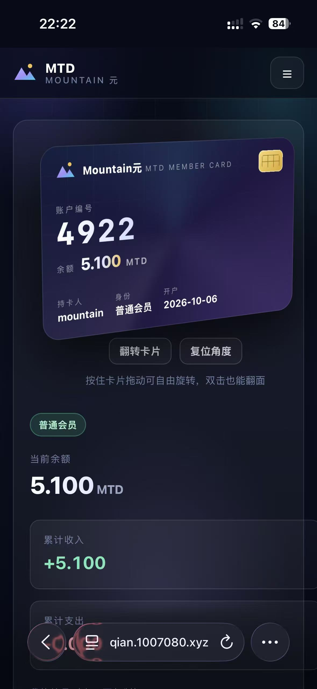

# Mountain元 · 站内积分系统（单文件 PHP）




一个**单文件、零依赖、无需数据库**的站内积分系统。上传一个 `index.php` 就能跑：注册登录、3D 账户卡、每日签到、答题奖励、编号/用户名转账、6 位转账密码、多币种汇率换算、管理后台，移动端与桌面端自适应。

> **免责声明**：本项目仅供学习、研究与自用部署。站内积分与汇率均为**演示数据**，与现实货币无关，不构成任何投资、兑换或收益承诺。请勿将本程序用于以虚拟货币、积分兑换等名义向他人收取资金的活动。

---

## 特性

- **单文件部署**：整个应用就是一个 `index.php`，不需要 composer、不需要数据库、不加载任何外部 CDN 资源
- **首次运行安装向导**：不再硬编码管理员密码，第一次访问站点时由你自行创建管理员账号，创建完成后安装入口自动关闭
- **3D 账户卡**：正面为 4 位账户编号 + 当前余额，背面为品牌 logo；可用鼠标/手指拖动自由旋转（带惯性）、双击翻面、键盘方向键旋转
- **双通道转账**：收款人支持 `0170`、`170`、`mountain`、`@mountain` 四种写法，可附转账备注
- **6 位转账密码**：可选开启，连续输错 5 次锁定 5 分钟，忘记可用登录密码重设，管理员也可在后台代为用户重置
- **服务端汇率换算**：8 种货币与站内积分互转，禁用 JavaScript 也能正常使用，汇率可在后台随时修改并即时生效
- **管理后台**：用户与余额调整、资金池补充/回收、账户注销与恢复、汇率设置、全站账单分页、重置用户转账密码
- **响应式**：手机端汉堡导航，账单表格在窄屏自动变为卡片式列表，卡片按屏幕宽度缩放
- **数据自持 + 防下载**：数据存成 `data/mountain.json.php`（`.php` 结尾 + `exit` 保护头），即使地址被猜到也下载不到内容；同时自动生成 `data/.htaccess` 拒绝外部访问
- **并发安全**：所有写操作走 `flock` 排他锁 + 临时文件原子替换，避免并发丢数据
- **安全基线**：全站输出转义、CSRF 校验、`password_hash` 存储密码与转账密码、登录失败限流、会话 Cookie `HttpOnly` + `SameSite=Lax`（HTTPS 下自动加 `Secure`）

## 环境要求

| 项目 | 要求 |
|---|---|
| PHP | 7.4 及以上（8.x 亦兼容；开发与测试基于 PHP 8.4） |
| 扩展 | 无需额外扩展。`mbstring` 可选，未安装时自动降级 |
| 数据库 | 不需要 |
| Web 服务器 | Apache / Nginx / 任何支持 PHP 的虚拟主机 |
| 目录权限 | `data/` 需可写（首次运行自动创建，一般 `755`） |

## 快速开始

1. 下载 `index.php`，上传到网站根目录
2. 浏览器打开站点首页 —— 第一次访问会进入 **「初始化安装」** 页面
3. 填写管理员用户名与密码（至少 8 位），提交后自动登录并进入后台
4. 到 **管理后台 → 汇率设置** 核对各币种汇率与「1 元人民币 = ? 积分」
5. 到 **安全设置** 确认密码强度；建议开启 HTTPS，并定期备份 `data/` 目录

## 目录结构

```
.
├── index.php          # 全部程序（唯一需要部署的文件）
├── README.md
├── LICENSE
├── .gitignore
└── data/              # 运行时自动创建，已被 .gitignore 忽略
    ├── mountain.json.php   # 数据文件（带 exit 保护头，无法从网址下载）
    ├── mountain.lock       # 并发写锁（0 字节，勿删）
    └── .htaccess           # 自动生成的访问保护
```

> `data/` 目录不需要手工创建，程序首次运行会自动建好。**请勿把 `data/` 提交进版本库**——里面有用户密码哈希与账目数据。

## 配置项

全部集中在 `index.php` 顶部「配置区」：

| 常量 | 默认值 | 说明 |
|---|---|---|
| `APP_NAME` | `Mountain元 · 站内积分系统` | 站点名称 |
| `APP_SHORT` | `MTD` | 简称（导航栏等） |
| `APP_TAGLINE` | 站内娱乐积分｜注册即送 5.000 MTD | 首页副标题 |
| `CONTACT_QQ` | 空 | 联系方式，**留空则页面不展示** |
| `UNIT` | `1000` | 内部记账单位（1 积分 = 1000 单位，账面 3 位小数） |
| `INITIAL_POOL` | `10000 * UNIT` | 初始资金池（奖励的唯一来源） |
| `REGISTER_BONUS` | `5 * UNIT` | 注册赠送 |
| `DAILY_BONUS` | `100` | 每日签到奖励（0.1） |
| `QUIZ_BONUS` | `100` | 每题奖励（0.1） |
| `QUIZ_DAILY_LIMIT` | `100` | 每人每日答题上限，`0` = 不限 |
| `TRANSFER_FEE_RATE` | `0.05` | 转账手续费率 |
| `TRANSFER_FEE_MIN` | `50 * UNIT` | 手续费起征点（超过才收） |
| `PIN_MAX_FAIL` | `5` | 转账密码连续错误上限 |
| `PIN_LOCK_SEC` | `300` | 转账密码锁定时长（秒） |
| `PER_PAGE` | `20` | 账单每页条数 |
| `DEBUG` | `false` | 改为 `true` 可显示详细报错（排查问题用） |

金额一律使用**整数单位**记账，避免浮点误差导致余额对不上。资金池恒等式：`资金池 + 所有账户余额 = INITIAL_POOL`（管理员手工调整资金池属外部注入，会等额改变总额）。

## 数据结构

数据以 JSON 存在 `data/mountain.json.php`，文件结构：

```jsonc
{
  "settings": {
    "pool": 10000000,              // 资金池（内部单位）
    "created_at": "2026-01-01 00:00:00",
    "rates": { "CNY": 1, "USD": 6.74, "HKD": 0.865, "EUR": 7.8,
               "SGD": 7.35, "AUD": 6.75, "CAD": 4.65, "KRW": 0.00072 },
    "mtd_per_cny": 1000,           // 1 元人民币 = ? 积分
    "schema": 2
  },
  "users": [
    {
      "id": "0000",                // 4 位编号，管理员固定 0000
      "username": "admin",
      "password": "$2y$10$...",    // password_hash
      "role": "admin",             // admin | user
      "balance": 0,
      "created_at": "2026-01-01 00:00:00",
      "last_checkin": null,        // Y-m-d
      "active": true,
      "pay_pin": "$2y$10$...",     // 6 位转账密码哈希，未设置为 null
      "pin_fail": 0,
      "pin_locked_until": 0,
      "last_quiz_date": null,
      "quiz_count": 0
    }
  ],
  "transactions": [
    {
      "id": "hex", "type": "transfer", "from_id": "0001", "to_id": "0002",
      "amount": 10000, "fee": 500, "description": "转账给 ...",
      "operator_id": null, "created_at": "2026-01-01 00:00:00"
    }
  ]
}
```

流水类型：`register_bonus`、`checkin`、`quiz`、`transfer`、`admin_add`、`admin_remove`、`account_deleted`、`pool_adjust`。

**备份**：下载整个 `data/` 目录即可（`mountain.lock` 可省略）。

## 常见问题

**打开是空白页 / 500 错误？**
把 `DEBUG` 改成 `true` 刷新看具体报错。最常见原因是 `data/` 目录不可写，或 PHP 版本低于 7.4。

**提示「无法锁定数据文件」？**
`data/` 目录不可写。Linux 主机执行 `chmod 755 data`（必要时 `777`）。

**忘记管理员密码了？**
数据库里只要还存在 `role = "admin"` 的账户，安装入口就不会再出现。请直接编辑 `data/mountain.json.php`：把该管理员记录的 `password` 字段替换成一段新的 `password_hash` 结果（可用 `php -r "echo password_hash('新密码', PASSWORD_DEFAULT);"` 生成），保存后即可用新密码登录。

**用户忘记转账密码？**
管理员在「用户与余额」里点「重置转账密码」即可；用户自己也可以在「安全设置」用登录密码重设。

**转账手续费怎么算？**
单笔 > `TRANSFER_FEE_MIN`（默认 50）时：手续费 = 金额 × 5%，向上取整到 0.001，手续费进入资金池，收款方收到全额；未超过起征点免手续费。

**升级过旧版本怎么办？**
只要把新 `index.php` 覆盖旧文件即可。如果同目录下存在旧版 `data/mountain.json`（明文 JSON），程序会在首次运行时自动导入到新数据文件，并把旧文件内容清空作废。**升级前请务必备份 `data/`。**

**能改配色/文案吗？**
可以。样式集中在 `index.php` 内 `<style>` 块（CSS 变量在 `:root`），文案直接在该文件里搜索中文即可。

## 安全说明

- 数据文件以 `.php` 结尾并带 `exit` 保护头，直接访问网址只会得到空白页
- 程序会在 `data/` 自动写入 `.htaccess` 拒绝外部访问（Apache 生效，其它环境无副作用）
- 密码与 6 位转账密码均以 `password_hash` 强哈希存储，不保存明文
- 所有 POST 请求校验 CSRF（`hash_equals`）；登录成功后重新生成会话 ID
- 登录失败 5 次限流 60 秒；转账密码连错 5 次锁定 5 分钟
- 建议：开启 HTTPS，并为站点配置定期备份
- 注意：本项目**不含**注册验证码/邮箱验证等反自动化注册手段，公开运营时请自行增加

## 许可

[MIT](LICENSE) —— 允许自由使用、修改与分发。
